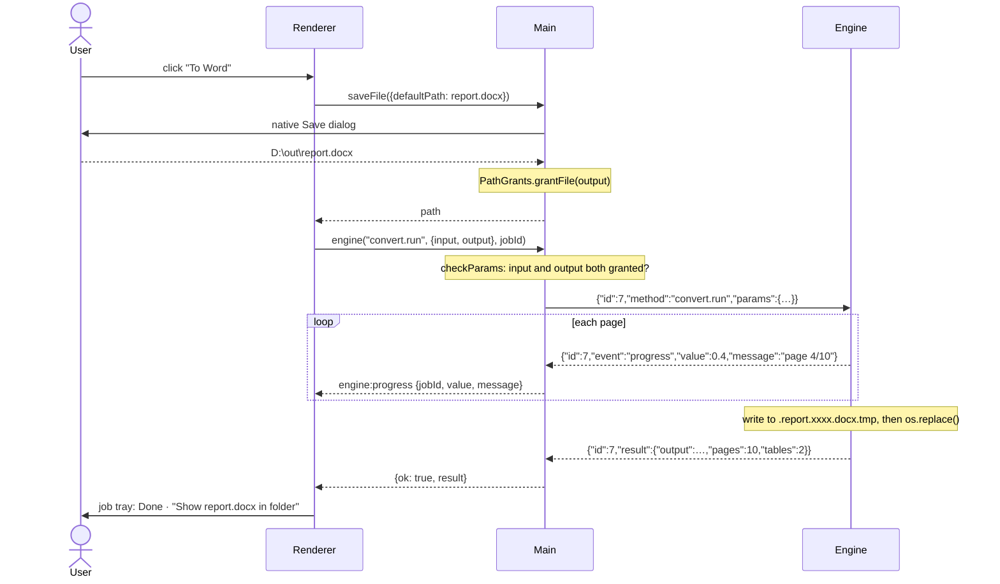

# DocSuite — System Architecture

Status: implemented and exercised by `engine/tests` and `scripts/smoke.cjs` unless a section says *planned*.

## 1. Overview

Three processes, one machine, no sockets.

```mermaid
flowchart LR
  subgraph R["Renderer process — sandboxed Chromium"]
    UI["React UI<br/>Home · PDF Studio · Spreadsheets (Univer) · Documents (TipTap) · Slides (Konva)"]
    SVC["services.tsx<br/>job tray · prompts · engine status"]
    UI --> SVC
  end

  subgraph P["Preload — contextBridge"]
    API["window.suite<br/>10 functions, typed in src/shared/api.ts"]
  end

  subgraph M["Main process — Node / Electron"]
    IPC["ipc.ts<br/>IPC handlers · native file dialogs"]
    GR["PathGrants<br/>allow-list of user-picked paths"]
    NET["Network lockdown<br/>webRequest filter · CSP · Chromium flags"]
    ENG["engine.ts<br/>child-process manager · request/response matching"]
    IPC --> GR
    IPC --> ENG
  end

  subgraph E["Processing engine — Python child process"]
    RPC["rpc.py<br/>JSON lines on stdin/stdout · worker pool"]
    H["handlers/<br/>pdf · pdf_edit · conversion · workbook · document · presentation · system"]
    CV["convert/<br/>converter registry: (from, to) → backend"]
    LIB["pypdf · pdfplumber · pypdfium2 · reportlab · Pillow<br/>python-docx · openpyxl · python-pptx · xlrd · odfpy · striprtf"]
    RPC --> H --> CV --> LIB
    H --> LIB
  end

  FS[("Local file system")]

  SVC -- "ipcRenderer.invoke" --> API
  API -- "IPC (structured clone)" --> IPC
  ENG -- "stdin: {id, method, params}" --> RPC
  RPC -- "stdout: result · error · progress" --> ENG
  LIB <--> FS
  NET -. "blocks every non-local request" .-> R
```



| Layer | Runs | Responsibility | Deliberately cannot |
|---|---|---|---|
| Renderer | Chromium, `sandbox: true`, `contextIsolation: true` | All UI and editor state | Touch Node, the file system, or the network |
| Preload | Isolated world | Expose `window.suite` (typed, 10 functions) | Expose `ipcRenderer` or any Node API |
| Main | Node | Windows, dialogs, path allow-list, engine lifecycle, network lockdown | — |
| Engine | Python (frozen binary when packaged) | Every byte of document processing | Open a socket (it has no network code) |

## 2. Why a child process over stdio, not a local HTTP server

A common pattern is a FastAPI/Flask server on `127.0.0.1`. It was rejected:

- **"Zero network calls" becomes literally true.** No port is opened, so nothing else on the machine (another user, a browser tab doing DNS rebinding, malware) can reach the engine. A localhost server needs token auth and port management to get to the same place.
- **No firewall prompt** on first launch on Windows/macOS.
- **Lifecycle is free.** The engine exits when its stdin closes; there are no orphaned servers.

Cost: stdout must carry only protocol lines. `__main__.py` re-points `sys.stdout` at stderr before any library is imported, so a stray `print` in a dependency cannot corrupt the stream.

## 3. One request, end to end (PDF → Word)



### Wire protocol

One JSON object per line, UTF-8.

```
→ {"id": 7, "method": "pdf.info", "params": {"input": "C:/docs/a.pdf"}}
← {"id": 7, "result": {"pages": 12, "encrypted": false, …}}
← {"id": 7, "error": {"code": "password_required", "message": "This PDF is password protected"}}
← {"id": 7, "event": "progress", "value": 0.4, "message": "page 4/10"}
← {"event": "ready", "methods": ["convert.batch", …]}          (once, at start-up)
```

Error codes are stable strings the UI branches on: `not_found`, `permission_denied`, `bad_params`, `password_required`, `invalid_pdf`, `unsupported_conversion`, `unsupported_format`, `unknown_method`, `internal`. Main adds `path_not_granted`, `engine_unavailable`, `engine_crashed`.

### Methods available today

| Namespace | Methods |
|---|---|
| `system` | `ping`, `info` |
| `pdf` | `info`, `render_page`, `to_images`, `merge`, `split`, `reorder`, `protect`, `watermark`, `apply_edits`, `text_lines`, `image_data_url`, `sign`, `signatures` |
| `convert` | `list`, `run`, `batch`, `images_to_pdf` |
| `sheet` | `open`, `save` (editor snapshot ⇄ xlsx/csv/tsv/xls), `read`, `write` (plain rows, used by mail merge) |
| `doc` | `open`, `save`, `image_data_url`, `merge_fields`, `mail_merge` |
| `slides` | `open`, `save`, `export_pdf`, `export_images`, `image_data_url` |

### Where each editor's document model lives

The three editors keep their document in the renderer, in the library's own model, and exchange it with the engine as JSON. The engine owns the file formats.

| Workspace | Editor (renderer) | Model sent over RPC | Engine converts to / from |
|---|---|---|---|
| Spreadsheets | Univer | workbook snapshot (cells, styles, merges, sizes, freeze) + chart specs | `.xlsx` via openpyxl; `.csv`/`.tsv`; `.xls` via xlrd |
| Documents | TipTap (ProseMirror) | document JSON (blocks, marks, images as data URLs) | `.docx` via python-docx; `.odt` via odfpy; `.rtf` (own writer, text-only reader); `.md`, `.txt` |
| Slides | Konva canvas | deck (slides → positioned text / shape / image elements) | `.pptx` via python-pptx; `.odp` via odfpy |
| PDF Studio | SVG overlay on rendered pages | page order + list of edits in PDF points | new PDF via pypdf + reportlab overlay; redaction via PDFium raster |

Each conversion is covered by round-trip tests in `engine/tests/`, and each workspace by a script in `scripts/smoke/` that drives the real UI and then reads the saved file back.

## 4. Conversion pipeline

`convert/__init__.py` is a registry keyed by `(source_ext, target_ext)`; each entry maps backend names to functions.

```python
@converter("pdf", "docx", backend="pdfplumber")
def pdf_to_docx(src: Path, dst: Path, options: dict, ctx: Context) -> dict: ...
```

`convert.run(input, output)` resolves the pair from the two file names, runs the backend against a temp file beside the target, and renames on success. Consequences:

- Adding a format is one decorated function — no changes to RPC, IPC or UI plumbing.
- A second backend for the same pair (e.g. LibreOffice for `docx → pdf`) registers under another name and is selected with `options.backend`. That is the intended upgrade path for layout fidelity.
- A failed or interrupted conversion never leaves a truncated file and never clobbers an existing one (covered by `test_failed_conversion_leaves_no_output`).

Registered today: `pdf → docx | xlsx | html | md | txt | zip(images)`, `docx | xlsx | csv | txt | md | png | jpg | bmp | tiff | gif | webp → pdf`.

## 5. Privacy and security model

The offline guarantee is enforced in four independent layers, so one failing does not break the promise:

1. **Chromium flags** (`main/index.ts`): background networking, component updates, sync, crash upload, DNS prefetch and several server-backed features are switched off.
2. **Request filter**: `session.webRequest.onBeforeRequest` cancels every request whose scheme is not `file:`, `data:`, `blob:` or `devtools:`. In development only, the Vite dev-server origin is also allowed.
3. **Content-Security-Policy** (production builds): `default-src 'none'; connect-src 'none'; script-src 'self'; …` injected by `electron.vite.config.ts`. The editor libraries run under it unchanged; the only relaxations are local ones (`font-src data:`, `worker-src blob:`).
4. **Engine**: our Python code never opens a connection. One dependency does contain an HTTP client: pyHanko (PDF signing) installs `aiohttp` for optional timestamping and revocation checks. Both are switched off here — signing passes no timestamper, and verification runs with `allow_fetching=False` and an empty trust list — so that code is never reached.

Also: all web permissions denied except the local clipboard and full-screen (needed by the editors and the slide show), spell-check dictionary download disabled, pop-ups and navigation blocked, no auto-updater, no telemetry SDK.

**File access is least-privilege.** The renderer can only pass the engine a path that the user chose in a native dialog during this session, or a file the engine itself wrote (`PathGrants` in `main/ipc.ts`). A compromised or buggy UI therefore cannot read `~/.ssh` or overwrite arbitrary files.

**Verified by `scripts/smoke.cjs`:** main-process request blocked · renderer request blocked · renderer has no `require`/`process` · un-picked path refused with `path_not_granted` (including a signing certificate path).

**Verified on the packaged Windows build:** after launch, the app's processes (shell, renderer, GPU, frozen engine) held zero TCP connections or listeners and zero UDP endpoints.

Not yet done: a longer packet-capture audit while every feature is exercised, and code signing/notarisation.

## 6. Performance approach

| Concern | Mechanism |
|---|---|
| Start-up | Each editor is a separate chunk loaded the first time its workspace is opened: the initial bundle is about 0.6 MB, while the spreadsheet engine alone is about 15 MB. Engine is spawned once at launch and kept warm; UI is usable before it is ready. openpyxl, python-pptx and reportlab are imported on first use rather than at start-up. |
| PDF rendering | PDFium is not thread-safe, so every call into it holds one lock (`PDFIUM_LOCK`); a regression test renders from 8 threads at once. |
| Large PDFs | Thumbnails render lazily (`IntersectionObserver`); pdfplumber page caches are flushed per page; images are streamed to disk one page at a time. |
| Large spreadsheets | At most 400 000 cells are loaded; a partly loaded workbook is flagged and cannot be saved, so rows are never silently lost. |
| Responsiveness | Four engine worker threads, so a long conversion does not block previews. |
| Batch | `convert.batch` reports per-file success/failure and never overwrites. |

Known ceiling: CPU-bound conversions share Python's GIL. When batch throughput matters, move `convert.batch` to a process pool (the handler signature does not change).

## 7. Packaging

Built and checked for Windows; `npm run dist` does all three steps.

1. **Engine → frozen program.** `scripts/build_engine.ps1` runs PyInstaller on `engine/run_engine.py` and writes `engine/dist/docsuite-engine/` (the exe plus its libraries, about 78 MB). Data files that libraries load at run time (Word and PowerPoint templates, PDFium, fonts, time-zone data) are collected explicitly.
2. **App → `out/`.** `electron-vite build`. Every UI dependency is bundled, so `package.json` lists them as devDependencies and no `node_modules` is shipped.
3. **Installer.** `electron-builder` packs `out/` into an asar archive, copies the frozen engine to `resources/engine/`, and produces an NSIS installer (about 155 MB; 457 MB installed). `engine.ts` starts `resources/engine/docsuite-engine.exe` when `app.isPackaged`. No update channel is configured (`publish: null`).

For testing a frozen engine without packaging, set `DOCSUITE_ENGINE` to the exe path; the full smoke suite passes that way.

Open items: code signing (unsigned builds trigger SmartScreen), an application icon, running the installer/uninstaller end to end, and macOS/Linux builds — each OS must freeze its own engine, so plan a three-runner CI matrix.

## 8. Repository layout

```
src/shared/api.ts            contract between renderer and main
src/main/                    index.ts (window, lockdown) · engine.ts · ipc.ts
src/preload/index.ts         window.suite bridge
src/renderer/src/            App.tsx · lib/ · components/ · styles.css
  modules/PdfStudio.tsx      + pdf/     model.ts · PageCanvas.tsx · SignaturePad.tsx
  modules/Sheets.tsx         + sheets/  univer.ts · ChartPanel.tsx
  modules/Documents.tsx      + docs/    editor.ts · Toolbar.tsx · templates.ts
  modules/Slides.tsx         + slides/  model.ts · SlideStage.tsx · SlideView.tsx · Inspector.tsx · SlideShow.tsx
engine/docsuite_engine/      rpc.py · util.py · handlers/ · convert/
engine/tests/                pytest suite (54 tests)
scripts/                     smoke.cjs + smoke/<workspace>.cjs (91 checks) · make_samples.py · build_engine.ps1
docs/                        this file · TECH_STACK.md · UI_WIREFRAME.md · screenshots/
```
